<div align="center">

  

  <br/><br/>

  <p align="center">
    <a href="https://github.com/ishandutta2007/Awesome-Awesome-Awesome"></a><a href="https://discord.gg/jc4xtF58Ve"></a>
    <a href="https://github.com/ishandutta2007/Awesome-Enterprise-Application-Platform/stargazers"></a>
    <a href="https://github.com/ishandutta2007/Awesome-Enterprise-Application-Platform/network/members"></a>
    <a href="https://github.com/ishandutta2007/Awesome-Enterprise-Application-Platform/blob/main/LICENSE"></a>
    <a href="https://github.com/ishandutta2007/Awesome-Enterprise-Application-Platform/pulls"></a>
    <a href="https://github.com/ishandutta2007"></a>
  </p>

  <p align="center">
    <strong>A curated directory of top-tier Enterprise Application Platforms (EAP), Low-Code Application Platforms (LCAP), Business Process Management (BPM) suites, and sovereign self-hosted developer frameworks.</strong>
  </p>

</div>

---

## 📑 Table of Contents

- [🎯 Overview & Architecture Focus](#-overview--architecture-focus)
- [📊 Sector Overview & Market Dynamics](#-sector-overview--market-dynamics)
- [☁️ Top Enterprise SaaS Platforms](#️-top-enterprise-saas-platforms)
- [🔓 High-Momentum Open-Source Frameworks](#-high-momentum-open-source-frameworks)
- [🧩 Architectural Stack Recommendations](#-architectural-stack-recommendations)
- [🤝 How to Contribute](#-how-to-contribute)
- [💖 Support & Sponsoring](#-support--sponsoring)
- [📈 Star History](#-star-history)
- [📄 License & Disclaimer](#-license--disclaimer)

---

## 🎯 Overview & Architecture Focus

**Enterprise Application Platforms (EAP)** and **Low-Code Application Platforms (LCAP)** supply the foundational runtime, visual schema designers, identity governance, event orchestration engines, and integration layers that organizations depend on to construct, modernize, and operate custom business systems.

From departmental productivity apps and internal CRUD dashboards to mission-critical core banking, supply-chain ERPs, and automated approval workflows, these platforms eliminate redundant boilerplate while enforcing enterprise-grade security, role-based access control (RBAC), and regulatory compliance.

### Key Technology Pillars:
- 🛠️ **Visual Modeling & UI Builders**: Drag-and-drop interfaces, responsive layouts, design token support, and reusable component libraries.
- ⚙️ **Process Automation & Workflow Engines**: Event-driven execution, BPMN 2.0 orchestration, RPA, and asynchronous background tasks.
- 🔐 **Governance & Security**: Single Sign-On (SSO/SAML/OIDC), zero-trust access, data masking, and comprehensive audit logs.
- 🔌 **Unified Integration Fabrics**: Pre-built enterprise connectors (REST, GraphQL, gRPC, SAP, Salesforce, SQL/NoSQL).
- 🤖 **Embedded Generative AI & Autonomous Agents**: Natural-language app generation, schema synthesis, and multi-agent task execution.

---

## 📊 Sector Overview & Market Dynamics

The global **Enterprise Application Platform (EAP)** and **Low-Code Development Platform (LCDP)** market was valued at **$28.5 Billion in 2024** and is projected to expand to **$118.8 Billion by 2032**, compounding at an aggressive **CAGR of 19.5% – 28.1%**.

Market dynamics exhibit **moderate fragmentation**:
- **Consolidated Mega-Cap Cloud Suites**: Industry giants like Microsoft, Salesforce, Oracle, SAP, and ServiceNow capture massive shares of Fortune 500 core enterprise spend by embedding application engines directly into their proprietary data lakes, ERPs, and CRM ecosystems.
- **Developer-Centric & Open-Source Sovereignty**: Simultaneously, high-growth open-source platforms (Supabase, Strapi, NocoDB, Appsmith, ToolJet) are decentralizing the landscape. These modern alternatives dominate greenfield developer adoption, internal tooling, and compliance-sensitive industries that mandate full data ownership without per-seat licensing lock-in.

---

## ☁️ Top Enterprise SaaS Platforms

The table below benchmarks the premier SaaS Enterprise Application Platforms, sorted strictly in **descending order by company valuation/revenue**.

| 🏢 Platform / Product | 💰 Company Size & Valuation | 🏷️ Starting Tier Pricing | 🎁 Free Tier & Trial Limits | ⚡ Key Capabilities & Enterprise Strengths |
| :--- | :--- | :--- | :--- | :--- |
| **[Microsoft Power Platform](https://powerplatform.microsoft.com/)** | **$3.12 Trillion** Market Cap<br/>*(~$245.1B FY24 Rev)* | **$5.00/user/app/month**<br/>*(or $20/user/month unlimited apps)* | **Free Forever** via Power Apps Developer Plan (1 dedicated environment, Dataverse, premium connectors, 2GB capacity) + 30-day trial with 25 licenses | Power Apps (canvas & model-driven), Power Automate RPA, Power Pages, Dataverse layer, Copilot Studio, and 1,800+ enterprise connectors. |
| **[Oracle Cloud Platform / APEX](https://www.oracle.com/cloud/)** | **$455 Billion** Market Cap<br/>*(~$53.0B FY24 Rev)* | **$115.00/month**<br/>*(APEX Service: 1 dedicated OCPU, 1TB storage)* | **Free Forever** via Oracle Cloud Always Free (2 Autonomous Databases with APEX pre-configured, 20GB storage each, 1/8 OCPU) + 30-day $300 trial credit | Autonomous Database backend, browser-based visual IDE, native SQL/PL/SQL integration, and zero-per-user licensing cost model. |
| **[Salesforce Platform](https://www.salesforce.com/products/platform/overview/)** | **$285 Billion** Market Cap<br/>*(~$34.9B FY24 Rev)* | **$25.00/user/month**<br/>*(Platform Starter / Starter Suite, annual billing)* | **Free Forever** via Salesforce Developer Edition (full Lightning platform, 2 Salesforce licenses, 5MB data/20MB file storage, REST/SOAP APIs) + 30-day trial | Lightning App Builder, Flow Orchestration, Prompt Builder for generative AI, Salesforce Shield encryption, and unified CRM Data Cloud. |
| **[SAP Business Technology Platform](https://www.sap.com/products/technology-platform.html)** | **$255 Billion** Market Cap<br/>*(~$34.1B FY24 Rev)* | **$11.80/user/month**<br/>*(SAP Build Apps standard user; Pay-As-You-Go from $0 base)* | **Free Forever** via SAP BTP Free Tier (SAP Build Work Zone standard up to 100 users, SAP HANA Cloud 32GB memory renewable every 90 days) + 90-day trial | SAP Build low-code/pro-code suite, Joule AI assistant, ABAP cloud migration tooling, and native SAP S/4HANA enterprise integration. |
| **[ServiceNow Now Platform](https://www.servicenow.com/now-platform.html)** | **$185 Billion** Market Cap<br/>*(~$10.5B FY24 Rev)* | **$100.00/user/month**<br/>*(App Engine Starter baseline; typical $10,000/yr min contract)* | **Free Forever** via Personal Developer Instance (PDI) on developer.servicenow.com (full sandbox with App Engine Studio; resets after 10 days inactivity) | App Engine Studio, Flow Designer, IntegrationHub, unified enterprise configuration management (CMDB), and cross-department workflows. |
| **[Workday Enterprise Management Cloud](https://www.workday.com/)** | **$68 Billion** Market Cap<br/>*(~$7.3B FY24 Rev)* | **$18.00/user/month**<br/>*(Workday Extend add-on; core platform from ~$99/user/month)* | **Free Forever** for registered customers/partners via Workday Developer Sandbox (up to 5 test tenant environments) + 30-day guided enterprise trial | Business Process Framework (BPF) spanning 850+ workflows, event-driven orchestration, and 100% immutable audit trails for finance/HR. |
| **[Zoho One / Creator](https://www.zoho.com/creator/)** | **~$15 Billion** Valuation<br/>*(Private; ~$1.5B ARR)* | **$8.00/user/month**<br/>*(Zoho Creator Standard, billed annually; or $37/emp/mo for Zoho One)* | **Free Forever** via Zoho Creator Free Plan (1 active user, 1 application, 250 records, 50MB storage) + 15-day free trial of Ultimate Plan | Deluge scripting language, visual drag-and-drop form/dashboard creator, Zoho Flow workflow connectors, and native iOS/Android PWA generation. |
| **[Pegasystems Infinity](https://www.pega.com/)** | **$6.5 Billion** Market Cap<br/>*(~$1.44B FY24 Rev)* | **$35.00/user/month**<br/>*(Case Management Edition; Pega Cloud Standard from $90/user/mo)* | **30-day free trial** via Pega Cloud Trial (full access to Pega Platform, App Studio, and Dev Studio with 1 sandbox environment & 5 user logins) | Pega Blueprint AI workflow design, Process AI predictive engine, Robot Studio for RPA, and enterprise decisioning frameworks. |
| **[Appian Platform](https://appian.com/)** | **$2.35 Billion** Market Cap<br/>*(~$605M FY24 Rev)* | **$2.00/user/month**<br/>*(Application user; Standard User from $75/user/month billed annually)* | **Free Forever** via Appian Community Edition (1 dedicated cloud sandbox tenant, full visual designer, Data Fabric, Process Mining, and AI agents) | AI Composer, Agent Studio multi-agent orchestration, Data Fabric virtual integration layer, and unified BPM automation engine. |
| **[Quickbase](https://www.quickbase.com/)** | **~$1.5 Billion** Valuation<br/>*(Private / Vista Equity; ~$225M ARR)* | **$35.00/user/month**<br/>*(Team plan, min 20 users, billed annually at $8,400/yr)* | **30-day free trial** (unlimited access to Quickbase Business plan with up to 50 users, AI Smart Builder, 10 apps, 500MB storage; no credit card) | AI-powered Smart Builder, Smart Data pipeline connecting legacy ERP/CRMs, real-time dashboards, and governed citizen-developer controls. |

---

## 🔓 High-Momentum Open-Source Frameworks

A comprehensive directory of leading open-source application platforms, low-code backends, and internal tool frameworks. Sorted in **descending order by GitHub Stars_Count**.

- **[Supabase](https://github.com/supabase/supabase)** [](https://github.com/supabase/supabase/stargazers) — The premier open-source Firebase alternative providing a complete backend-as-a-service foundation: PostgreSQL database with row-level security (RLS), instant REST/GraphQL APIs, Realtime WebSockets, Authentication, Edge Functions, and Vector storage.
- **[Strapi](https://github.com/strapi/strapi)** [](https://github.com/strapi/strapi/stargazers) — Leading open-source headless CMS and extensible TypeScript/Node.js application backend. Offers visual content type builders, customizable admin consoles, media asset management, and enterprise-grade role-based access control (RBAC).
- **[NocoDB](https://github.com/nocodb/nocodb)** [](https://github.com/nocodb/nocodb/stargazers) — Open-source Airtable alternative that instantly transforms existing SQL databases (PostgreSQL, MySQL, SQL Server, SQLite) into smart relational spreadsheets with Kanban, Gallery, Form, and Grid views alongside webhook automations.
- **[PocketBase](https://github.com/pocketbase/pocketbase)** [](https://github.com/pocketbase/pocketbase/stargazers) — High-performance, single-binary open-source backend written in Go. Packs an embedded SQLite database with real-time subscriptions, built-in admin dashboard UI, file storage, and OAuth2 authentication into a single executable.
- **[Twenty](https://github.com/twentyhq/twenty)** [](https://github.com/twentyhq/twenty/stargazers) — Modern open-source CRM and enterprise application platform designed as an extensible, developer-friendly alternative to Salesforce. Built on TypeScript and React with metadata-driven custom objects, GraphQL APIs, and workflow tasks.
- **[Appwrite](https://github.com/appwrite/appwrite)** [](https://github.com/appwrite/appwrite/stargazers) — Complete self-hosted backend platform packaged in Docker containers. Furnishes developers with user authentication, multi-database query engines, file storage, scheduled serverless cloud functions, and real-time event streaming.
- **[Metabase](https://github.com/metabase/metabase)** [](https://github.com/metabase/metabase/stargazers) — Open-source Business Intelligence and embedded analytics application platform. Connects to 20+ databases, allowing teams to build self-serve dashboards, SQL queries, and interactive KPI visualizations directly inside custom enterprise portals.
- **[ToolJet](https://github.com/ToolJet/ToolJet)** [](https://github.com/ToolJet/ToolJet/stargazers) — Open-source low-code internal tool builder featuring 80+ pre-built drag-and-drop components, built-in ToolJet Database (PostgreSQL), integrations for 90+ data sources, granular permissions, and custom JS/Python execution.
- **[Appsmith](https://github.com/appsmithorg/appsmith)** [](https://github.com/appsmithorg/appsmith/stargazers) — Developer-first low-code framework for building administrative portals, dashboards, and database GUIs. Connects to PostgreSQL, MongoDB, Snowflake, and REST APIs with native git-backed version control and JavaScript scripting.
- **[Directus](https://github.com/directus/directus)** [](https://github.com/directus/directus/stargazers) — Open-source data engine and backend platform that layers an instant real-time REST and GraphQL API directly over any existing SQL database, paired with an intuitive no-code admin studio for content, file, and user management.
- **[Refine](https://github.com/refinedev/refine)** [](https://github.com/refinedev/refine/stargazers) — React-based meta-framework designed for rapid development of enterprise internal tools, admin panels, B2B portals, and CRUD apps. Decouples UI from business logic with built-in integrations for Ant Design, Material UI, Mantine, and Tailwind CSS.
- **[Budibase](https://github.com/Budibase/budibase)** [](https://github.com/Budibase/budibase/stargazers) — Open-source low-code platform optimized for internal tools and business operations apps. Features autogenerated CRUD screens, multi-database query engines, built-in automation steps, and self-hosting across Docker and Kubernetes.
- **[ILLA Cloud](https://github.com/illacloud/illa-builder)** [](https://github.com/illacloud/illa-builder/stargazers) — Open-source low-code builder fusing UI component generation with AI agent workflows. Enables rapid construction of internal tools, connectors to PostgreSQL/REST, and natural-language prompt automation.
- **[Baserow](https://github.com/baserow/baserow)** [](https://github.com/baserow/baserow/stargazers) — Open-source no-code relational database and application builder built on Django and Nuxt.js. Delivers unlimited rows, self-hosted data ownership, and real-time collaborative editing for operational workflow applications.
- **[Saltcorn](https://github.com/saltcorn/saltcorn)** [](https://github.com/saltcorn/saltcorn/stargazers) — Extensible open-source no-code database management and web application builder with a rich plugin ecosystem, point-and-click layout designer, and granular role permissions on PostgreSQL.
- **[CUBA Platform](https://github.com/cuba-platform/cuba)** [](https://github.com/cuba-platform/cuba/stargazers) — High-level open-source Java/Spring-based rapid enterprise application development framework (evolved into Jmix) tailored for data-centric enterprise business software, complex ERP rebuilds, and BPM orchestration.
- **[Joget DX](https://github.com/jogetworkflow/jw-community)** [](https://github.com/jogetworkflow/jw-community/stargazers) — Open-source low-code application development platform combining Business Process Management (BPM) workflow engines with visual UI drag-and-drop designers, supporting enterprise governance and multi-database connectivity.
- **[Rintagi](https://github.com/Rintagi/Low-Code-Development-Platform)** [](https://github.com/Rintagi/Low-Code-Development-Platform/stargazers) — Developer-centric open-source low-code development platform designed for building scalable, responsive, mission-critical web applications with full C#/.NET code access and database generation.

---

## 🧩 Architectural Stack Recommendations

When architecting a production enterprise platform stack, consider these battle-tested blueprints:

```
┌────────────────────────────────────────────────────────────────────────┐
│                        ENTERPRISE USER INTERFACE                       │
│    Appsmith / ToolJet / Refine / Retool / Budibase / React / Vue       │
└───────────────────────────────────┬────────────────────────────────────┘
                                    │
┌───────────────────────────────────▼────────────────────────────────────┐
│                       INTEGRATION & API GATEWAY                        │
│             Directus / Supabase / Kong / Apisix / GraphQL              │
└──────────────────┬────────────────────────────────┬────────────────────┘
                   │                                │
┌──────────────────▼────────────────┐ ┌─────────────▼────────────────────┐
│      BPM & WORKFLOW ENGINE        │ │        DATA & STORAGE LAYER      │
│  Joget DX / Temporal / Camunda    │ │  PostgreSQL / MongoDB / Dataverse │
└───────────────────────────────────┘ └──────────────────────────────────┘
```

1. **Sovereign Self-Hosted Internal Tool Stack**:
   - **Frontend UI**: [Appsmith](https://github.com/appsmithorg/appsmith) or [ToolJet](https://github.com/ToolJet/ToolJet)
   - **Backend Engine & Auth**: [Supabase](https://github.com/supabase/supabase) or [Directus](https://github.com/directus/directus)
   - **Analytics & BI**: [Metabase](https://github.com/metabase/metabase)
2. **Citizen-Developer & Departmental Workflow Stack**:
   - **Spreadsheet DB**: [NocoDB](https://github.com/nocodb/nocodb) or [Baserow](https://github.com/baserow/baserow)
   - **Automation**: [Budibase](https://github.com/Budibase/budibase)
3. **Mission-Critical Core Business System**:
   - **Enterprise Framework**: [CUBA Platform / Jmix](https://github.com/cuba-platform/cuba) with Spring Boot
   - **Workflow Engine**: [Joget DX](https://github.com/jogetworkflow/jw-community)

---

## 🤝 How to Contribute

Contributions from enterprise architects, platform engineers, and open-source maintainers are warmly welcome! 🌟

1. **Fork this repository** to your GitHub account.
2. **Add or refine an entry** in `README.md` following the established tabular or list structure.
3. **Ensure strict data accuracy**:
   - For SaaS products: Provide verified starting-tier pricing and non-generic free tier / trial specifications.
   - For Open-Source projects: Verify active maintenance, GitHub repository URL, and license terms.
4. **Submit a Pull Request (PR)** with a clear explanation of why the tool qualifies as an Enterprise Application Platform.

---

## 💖 Support & Sponsoring

Thank you for exploring and bookmarking the **Awesome Enterprise Application Platform** repository! 🚀

If this curated directory helped you benchmark vendor platforms, architect internal tooling, or discover sovereign open-source solutions, please consider supporting the project:

- ⭐ **Star this repository** on GitHub to help boost visibility for the community.
- 🍴 **Fork the repository** to contribute updates or customize for your enterprise team.
- 📢 **Share with colleagues**, IT platform leads, and cloud architects.
- ☕ **Sponsor or Buy Me a Coffee**: Ongoing research, market updates, and ecosystem maintenance are supported through the [GitHub Sponsors Dashboard](https://github.com/sponsors/ishandutta2007).

<p align="center">
  <a href="https://github.com/sponsors/ishandutta2007">
    
  </a>
</p>

---

## 📈 Star History

[](https://star-history.dera.page/#ishandutta2007/Awesome-Enterprise-Application-Platform&type=date&legend=top-left)

---

## 📄 License & Disclaimer

- **License**: Released under the [MIT License](LICENSE).
- **Disclaimer**: This is an independent, community-driven resource. All product names, logos, and brands are property of their respective owners. Commercial deployments of enterprise application platforms must always be audited for organizational governance, data residency, GDPR/HIPAA compliance, and security posture.

---

<p align="center">
  <sub>Curated with ❤️ by <a href="https://github.com/ishandutta2007">Ishan Dutta</a> and the global open-source community.</sub>
</p>
